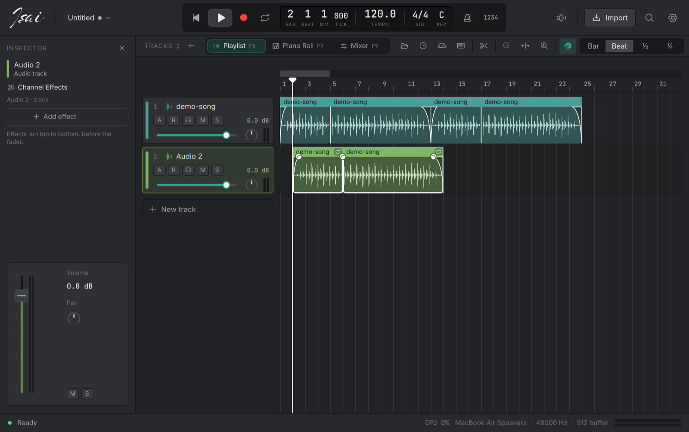

# Isai Studio Pro

**A free, open-source digital audio workstation for macOS, Windows and Linux,
built so that anyone, including people on old or low-spec computers, can make music.**

*Isai* (இசை) is Tamil for *music*.



> **Status: early development (v0.0.1).** It is usable for making songs, but
> project files may still change between versions. See [FEATURES.md](FEATURES.md)
> for what is done and what is next.

## Why Isai

- **Free forever.** GPL-3.0, no account, no login, no internet required.
- **Runs on low-spec PCs.** The target is a dual-core CPU, 4 GB of RAM and integrated graphics.
  Eco mode, track freeze, and switches for every animation and visual effect keep it light.
- **Easy to start, deep when you need it.** Simple and Pro views, project templates,
  and a command palette (⌘K / Ctrl+K) that finds any command.

## Features

**Arrange and record**
- Audio and instrument tracks: move, trim, split, fade, crossfade, loop, join, gain, reverse, normalize
- Undo for every edit, with a history list to jump back several steps
- Markers (Intro, Verse, Chorus…), a cycle region (⌘U wraps it around the selected regions), snap and grid
- Record audio with count-in, input monitoring and latency compensation; record MIDI from a keyboard
- Time-stretch audio to follow the song tempo, with tempo detection
- Built-in chromatic tuner

**Instruments**
- **Isai Synth**: two oscillators, sub, noise, drive, filter, two envelopes, LFO and unison
- **Isai Piano**: nine tones, including electric, reed and funk keys
- **Isai Drums**: synthesised 808, Club, Acoustic, Lo-fi and Trap kits with a step sequencer
- **Isai Sampler**: play a sound across the keys, or slice a loop evenly or on its beats

**Piano roll**
- Draw, move and stretch notes; velocity lane; quantize with strength and swing
- Scale highlighting, ghost notes, chord stamps, strum and arpeggiate

**Mix and master**
- Mixer with channel strips, meters, buses and sends; volume, pan and effect automation
- 13 effects: EQ (8 bands, live analyzer), compressor, limiter, reverb, delay, chorus,
  flanger, phaser, distortion, bitcrusher, gate, de-esser and Pitch Correct
- Mastering assistant: listens to the mix and sets up EQ, compressor and limiter
  for streaming (−14 LUFS), loud, or gentle targets
- Export the song, the cycle region or stems to WAV and FLAC

**Sounds**
- Browser with favourites and search; preview sounds in time with the song; drag them onto tracks

**Look**
- A painted start screen, and a Logic-style Studio theme in the Meadow palette (forest, lake, leaf, sun, peach, clay)
- An Inspector (I) with the selected track's instrument, effects and a big fader
- The paintings are generated by `tools/paint_art.py`, so all the art is ours to ship
- Import WAV, FLAC, MP3, OGG, AAC/M4A and AIFF

Press **?** in the app for the full list of keyboard shortcuts.

## Build and run

You need [Rust](https://rustup.rs) 1.88 or newer and **Qt 6.9 or newer** (the UI is Qt Quick / QML, bridged with [cxx-qt](https://github.com/KDAB/cxx-qt)).

```sh
# macOS
brew install qtbase qtdeclarative qtsvg qtshadertools

# Windows / Linux: install Qt 6.9+ with the Qt online installer or aqtinstall,
# then point the build at it:
#   set QMAKE=C:\Qt\6.9.0\msvc2022_64\bin\qmake.exe     (Windows)
#   export QMAKE=~/Qt/6.9.0/gcc_64/bin/qmake              (Linux)
# Linux also needs ALSA headers: sudo apt install libasound2-dev pkg-config

cargo run --release              # start the app
cargo run --release -- song.wav  # start with a new project containing this file
```

Distro Qt packages are often older than 6.9 (Ubuntu 24.04 ships 6.4), so on
Linux use the Qt installer or aqtinstall.

Other useful commands:

```sh
cargo test --workspace                                # run all tests
cargo clippy --workspace --all-targets -- -D warnings  # lint (CI runs this)
cargo run -p isai-engine --release --example bench     # benchmark your CPU
```

### Screenshots without clicking around

The app can open a screen, save it as an image and quit. `ISAI_CONFIG_DIR`
keeps your real settings untouched:

```sh
ISAI_CONFIG_DIR=/tmp/isai-test ISAI_SCENE=studio ISAI_SCREENSHOT=/tmp/studio.png cargo run -- song.wav
```

Scene names are listed in `crates/app/qml/Main.qml`.

## Settings file

| OS | Location |
|---|---|
| macOS | `~/Library/Application Support/isai/settings.toml` |
| Windows | `%APPDATA%\isai\config\settings.toml` |
| Linux | `~/.config/isai/settings.toml` |

Delete it to run the first-launch setup again, or use **Settings → Run setup again**.

## Code layout

```
crates/
├── engine/     real-time audio: device stream, playback, instruments, effects,
│               time-stretch, export (no UI code)
├── project/    the song model: tracks, regions, notes, markers, undo history, save/load
├── settings/   preferences, performance profiles, hardware detection
└── app/        the desktop app
    ├── src/        Rust side: AppController (QML ↔ engine bridge), tuner, slicer,
    │               mastering, waveform painter
    ├── qml/        the interface
    │   ├── Theme.qml       design tokens: every colour, size, font, duration
    │   ├── Icons.qml       icon names → Phosphor codepoints
    │   ├── components/     reusable controls (buttons, knobs, toggles…)
    │   └── pages/          setup, studio, editors, instrument windows, dialogs
    └── assets/
        ├── fonts/      Inter, JetBrains Mono, Young Serif, Phosphor icons
        ├── art/        painted backdrops, made by tools/paint_art.py
        └── brand/      logo images; originals in brand/source/, rebuild with tools/brand.py
```

[HANDOFF.md](HANDOFF.md) explains how the pieces fit together, for anyone picking up the code.

## Rules for contributors

1. **The audio thread never allocates, frees, locks, prints or does I/O.**
   It talks to the UI only through lock-free queues and atomics; anything to free is
   handed back to the UI thread. See `crates/engine/src/processor.rs`.
2. **The engine crate never depends on UI code.**
3. **Every edit is one undo step**, made through the project's edit helper.
4. **Use the design system.** Colours, sizes and fonts come from `Theme`; icons from `Icons`;
   text is `DText`. Never hard-code a colour in a page.
5. **Every animation uses `Theme.fast` / `Theme.slow`**, so the user's animation setting
   (including Off) is always respected.
6. **Every new heavy feature needs a low-spec option** in settings, and effects check `Theme.effects`.
7. **The UI only polls the engine while something moves** (`app.busy`), so the app uses no CPU when idle.

## Credits

Qt (LGPL-3.0), [cxx-qt](https://github.com/KDAB/cxx-qt) (MIT/Apache-2.0),
[Phosphor Icons](https://phosphoricons.com) (MIT),
[Inter](https://rsms.me/inter/), [JetBrains Mono](https://www.jetbrains.com/lp/mono/) and [Young Serif](https://github.com/noirblancrouge/YoungSerif) (SIL Open Font License).
The Meadow colour palette comes from a palette shared by the artist absentmirror; the paintings themselves are generated by Isai's own script.

## License

[GPL-3.0-or-later](LICENSE). Isai is built on Qt (LGPL-3.0), open-source Rust
libraries and open fonts; see [THIRD-PARTY-NOTICES.md](THIRD-PARTY-NOTICES.md)
for every one and its licence. Logic Pro, FL Studio and other products named
here are trademarks of their owners; Isai is not affiliated with them.
